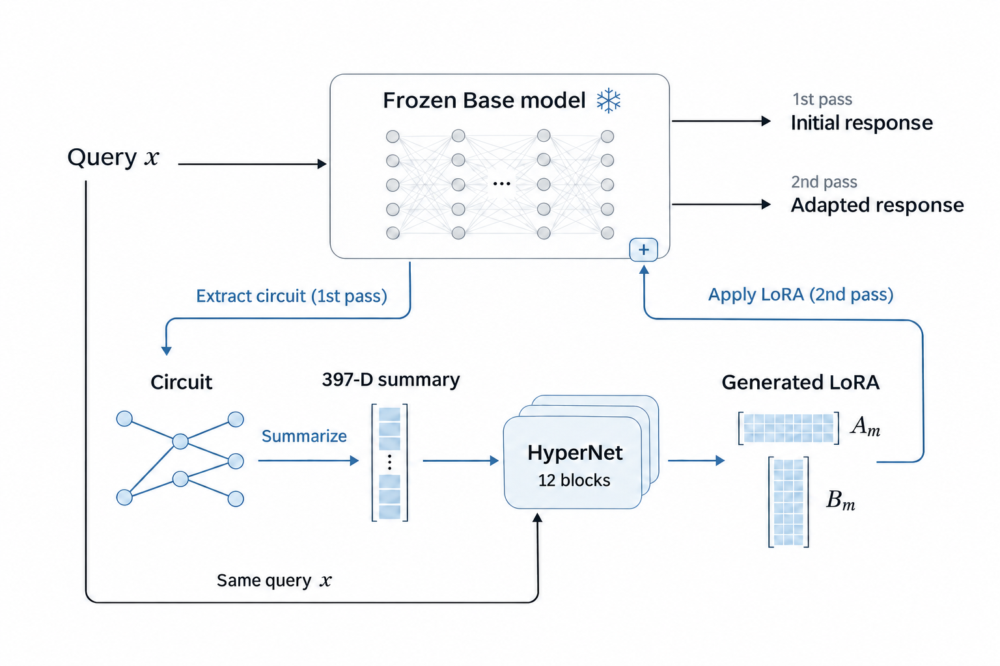
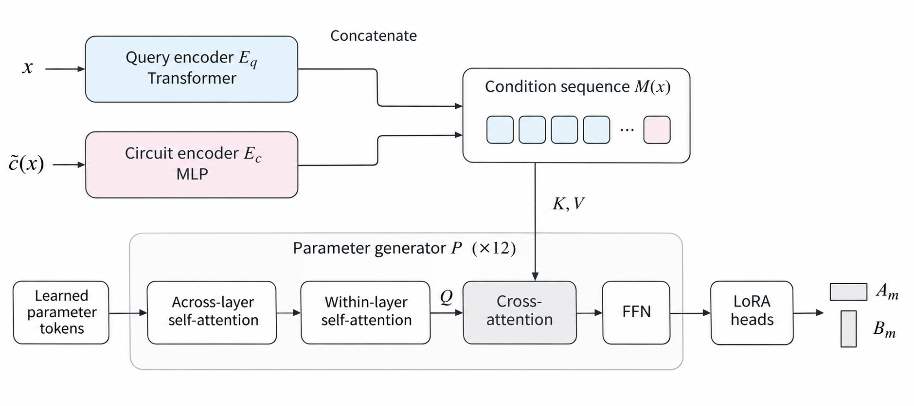
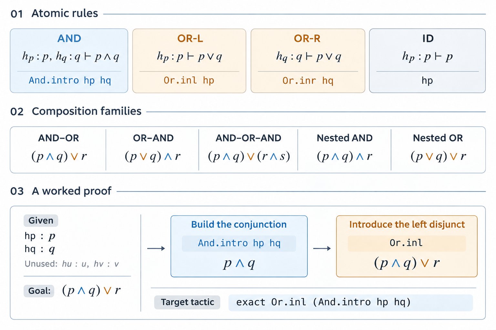
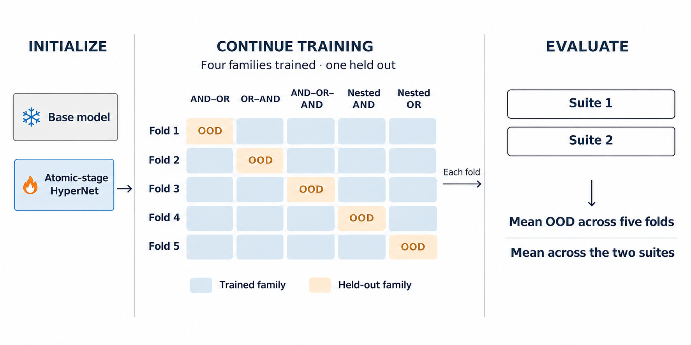
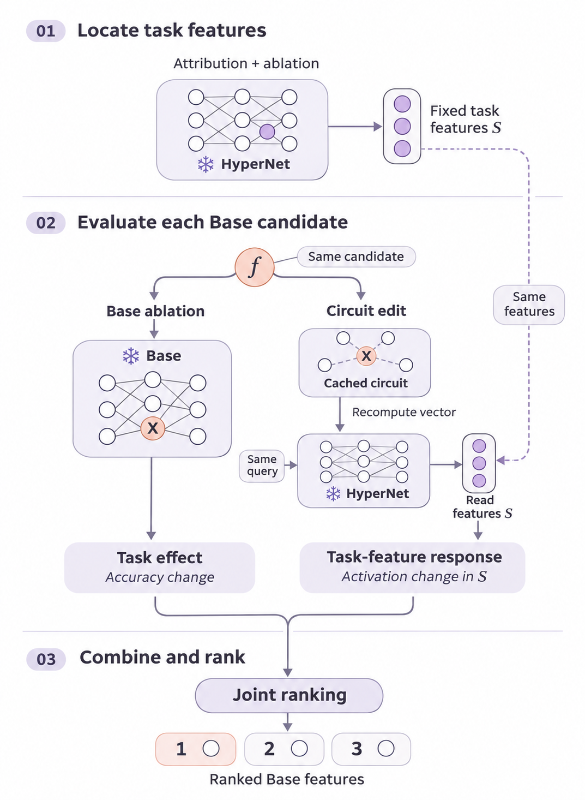

# Circuit-HyperNet: Guiding parameter generation and compositional reasoning with internal computation

[Junqi Zhang](mailto:zjq91573@gmail.com)¹, [Jie Fu](mailto:jie.fu@iquestlab.com)†²

¹ Peking University · ² IQuest Research

† Corresponding author: [jie.fu@iquestlab.com](mailto:jie.fu@iquestlab.com)

[Download PDF](Circuit-HyperNet.pdf) · [GitHub repository](https://github.com/Veri-Safe/circuit-hypernet)

## Abstract

Using one neural network to generate or modify another model's parameters is becoming a new route to model adaptation and error correction ([Ha et al., 2017](https://openreview.net/forum?id=rkpACe1lx); [Charakorn et al., 2025](https://proceedings.mlr.press/v267/charakorn25a.html); [Takehi et al., 2026](https://rikiyat.github.io/blog/weight-space-programming/)). Hypernetworks can generate adaptation parameters directly from task descriptions ([Ivison et al., 2023](https://aclanthology.org/2023.acl-long.631/); [Charakorn et al., 2025](https://proceedings.mlr.press/v267/charakorn25a.html)), while  closed-weight language models can analyze a target model and edit its weights to repair specific failures ([Takehi et al., 2026](https://rikiyat.github.io/blog/weight-space-programming/)). Yet each approach leaves a gap: parameter generation based only on task descriptions cannot observe the target model's internal computation on the current problem, and weight repair for specific failures often requires a clearly identified symptom before the relevant weights can be located and modified.

We introduce **Circuit-HyperNet** (**C-HyperNet**). With the base model frozen, we first extract a local attribution graph, or circuit ([Ameisen et al., 2025](https://transformer-circuits.pub/2025/attribution-graphs/methods.html)), from its initial attempt at the current problem. This graph describes internal features and their influence relationships. We summarize it as a fixed-length vector ([Zhao et al., 2025](https://arxiv.org/abs/2510.09312); [He et al., 2026](https://arxiv.org/abs/2602.07080)) and feed it, together with the original problem (query), into a small hypernetwork (HyperNet). HyperNet generates a problem-specific low-rank parameter update (LoRA) ([Hu et al., 2022](https://openreview.net/forum?id=nZeVKeeFYf9)), which the base model uses for a second attempt. Our central intuition is that problems with different wording but shared logical structure often exhibit similar internal representation dynamics ([Zhou et al., 2026](https://proceedings.iclr.cc/paper_files/paper/2026/hash/7644353d580a9e027e0069d6480d971b-Abstract-Conference.html)). These shared computational patterns may provide a basis for learning general rules for parameter correction and help connect compositional out-of-distribution (OOD) tasks—novel combinations of familiar atomic operations not encountered during training ([Press et al., 2023](https://arxiv.org/abs/2210.03350); [Dziri et al., 2023](https://arxiv.org/abs/2305.18654); [Yuan et al., 2025](https://arxiv.org/abs/2509.25123))—to familiar atomic capabilities. Training uses the adapted model's prediction loss on the correct answer as supervision, without manual error-cause annotations or example-specific instructions about which parameters to modify. Conceptually, C-HyperNet offers a middle ground between static supervised fine-tuning (SFT) and gradient-based test-time fine-tuning (TTFT) by amortizing test-time adaptation into a single forward pass of an offline-trained hypernetwork, while linking mechanistic interpretability with capability improvement.

On Lean logical proof tasks ([Sheng &amp; Fu, 2026](https://arxiv.org/html/2607.18921v3#S3.SS1)), C-HyperNet raises mean atomic-task accuracy from 43.98% for the supervised fine-tuned base model to 71.00%. On unseen composition families held out during training, it achieves a five-fold mean OOD accuracy of 13.14%, substantially above a query-only hypernetwork (Query-only, 4.60%) and direct supervised fine-tuning (Direct SFT, 6.34%), and ahead of a hypernetwork that additionally reads static base-model weights (Raw-weight, 10.58%), with gains concentrated in specific composition families. On ARC-AGI-1 grid reasoning tasks ([Chollet, 2019](https://arxiv.org/abs/1911.01547)), directly applying the generated LoRA achieves performance close to supervised fine-tuning. For test-time fine-tuning (TTFT) ([Sun et al., 2020](https://arxiv.org/abs/1909.13231); [Akyürek et al., 2025](https://arxiv.org/abs/2411.07279)) on the same supervised fine-tuned base model, replacing standard initialization with the generated LoRA further raises accuracy from 45.875% to 47.875%.

Learning to read circuits also brings an unexpected analytical benefit: task-related responses to circuits inside HyperNet can serve as an additional signal for locating functional nodes in the base model. Combining these responses with conventional attribution and ablation evidence yields higher functional selectivity in preliminary experiments on all four atomic tasks: the selected nodes' effects are more concentrated on the target task. A model that learns to use circuits may, in turn, help us understand them.

---

## 1. Motivation: how can internal computation guide parameter updates when a model gets an answer wrong?

Having one neural network generate or rewrite another neural network's parameters offers an intriguing way to improve and correct model capabilities ([Ha et al., 2017](https://openreview.net/forum?id=rkpACe1lx); [Charakorn et al., 2025](https://proceedings.mlr.press/v267/charakorn25a.html); [Takehi et al., 2026](https://rikiyat.github.io/blog/weight-space-programming/)). Recent research has demonstrated its potential in two directions. Conditional hypernetworks generate adaptation parameters directly from natural-language task descriptions, as in [HINT (Ivison et al., 2023)](https://aclanthology.org/2023.acl-long.631/) and [Text-to-LoRA](https://proceedings.mlr.press/v267/charakorn25a.html) (Charakorn et al., 2025).  Closed-weight language-model agents instead inspect internal states and run repeated experiments to rewrite a target model's weights, as in [Weight-Space Programming](https://rikiyat.github.io/blog/weight-space-programming/) (Takehi et al., 2026).

MIT's experiment using  a closed-weight model to repair Qwen's weights ([Takehi et al., 2026](https://rikiyat.github.io/blog/weight-space-programming/)) illustrates the latter approach. On mathematics problems, Qwen sometimes repeats a stretch of reasoning until it exhausts its token budget without producing an answer. The researchers described this specific failure in the prompt, guiding  the closed-weight model to investigate Qwen's internal computation and repeatedly test weight edits on practice problems, ultimately mitigating the looping behavior ([initial experimental instructions](https://github.com/RikiyaT/lm_understand-logs/blob/main/exp8_math/runs/p50c/turns/t001/prompt.txt), 2026). Another contemporary study, iWSP, asks  a closed-weight model to write the weights of small Transformers from scratch, using task specifications, implementation hints, algorithmic knowledge, and evaluation feedback ([iWSP paper](https://arxiv.org/html/2611.18114v1#S2) (Mehta et al., 2026) · [experimental prompts and rules](https://github.com/csinva/weight-space-programming-autoresearch/blob/main/experiments/runs/opus55/gcd-three-digits-opus55-s2/program.md), 2026). The resulting models can be understood step by step by reading the code that constructs their weights. However, because this procedure builds parameters from scratch, it does not readily extend to taking over and modifying an already trained, complex black-box network. If  the closed-weight model neither  possesses a capability nor can acquire it from feedback, the small model  is unlikely to acquire that capability through its generated weights either.

Like that weight-editing experiment, we aim to **correct a model's behavior using the computation that actually takes place inside it**. **The key distinction is that the Qwen weight-space programming experiment found a lasting patch to reuse, whereas C-HyperNet learns a rule for making per-query patches:** once found, the Qwen loop-reduction edit stays in the weights with no need to diagnose each new question again; C-HyperNet instead targets situations where the useful edit depends on the question, and where correct answers are available for training even when nobody can say which reasoning step failed or which weights should change ([Takehi et al., 2026](https://rikiyat.github.io/blog/weight-space-programming/)). Many reasoning failures, however, do not  present an overt, single-point surface pathology: in the same study's control experiment on Gemma, where math failures were ordinary arithmetic and algebraic errors lacking a single isolated defect, targeted weight editing yielded minimal gains ([Takehi et al., 2026](https://rikiyat.github.io/blog/weight-space-programming/)). Often, we know only that the answer is wrong, with little indication of where the failure occurred: surface outputs and chain-of-thought rationales can fail to faithfully reflect the internal computation behind a prediction ([Turpin et al., 2023](https://arxiv.org/abs/2305.04388); [Lanham et al., 2023](https://arxiv.org/abs/2307.13702)) or pinpoint how a reasoning step went wrong ([Zhao et al., 2025](https://arxiv.org/abs/2510.09312)). For example, strong noise perturbations to internal representations may cause a model to emit garbled or meaningless text ([Lin et al., 2026](https://arxiv.org/html/2605.10611v1#S2.SS1)). Such outputs give researchers little basis for identifying a clear failure mode, let alone precisely specifying which nodes to modify—and even in factual knowledge editing, prior work finds that causal localization of internal components does not reliably predict which weights are best to edit ([Hase et al., 2023](https://arxiv.org/abs/2301.04213)).

This motivates a direction  in the spirit of [Sutton's Bitter Lesson (2019)](https://www.cs.utexas.edu/~eunsol/courses/data/bitter_lesson.pdf), which observes that general learning methods scaling with data and compute ultimately outperform approaches relying on human-encoded heuristics. In weight repair, asking a human to name a symptom, classify the failure mode, and guide which components to inspect embeds case-by-case diagnostic priors that do not scale when failures are subtle or distributed. Rather than encoding those diagnostic rules by hand, we shift the diagnosis-to-edit mapping into end-to-end learning: we  extract the computational graph of the model's reasoning, summarize it as a **circuit vector**, and give it together with the problem to another neural network, **HyperNet**. End-to-end supervision from many problem–answer pairs can then teach HyperNet to generate appropriate parameter updates for the base model from its internal computational features. (Our current fixed-length summary statistics still retain representation priors, so we view this as a pragmatic step in that direction rather than its endpoint.)

_Illustration: Three approaches to parameter correction (the frozen base model is labeled `Base` in the figure). (1) **An explicit failure and targeted agent intervention:** a human identifies a clear symptom, such as repeated reasoning, and guides an agent to locate and modify the relevant weights. (2) **The difficulty of diagnosing ordinary failures:** an incorrect or even garbled answer may reveal little about the internal fault or where to make a change. (3) **Data-driven C-HyperNet:** the circuit from the base model's first attempt is summarized as a vector and supplied with the query to HyperNet, which learns to generate per-query LoRA updates end to end from correct-answer supervision, without manually annotated error causes or specified nodes._

Here, a **circuit** is a local attribution graph extracted from the base model's first attempt at the current problem. Its nodes represent internal features involved in that computation, and its directed edges describe the strength of their influence on subsequent computation and the final output ([Circuit Tracing](https://transformer-circuits.pub/2025/attribution-graphs/methods.html), Ameisen et al., 2025). [CRV](https://arxiv.org/html/2510.09312v2#S4.SS4) (Zhao et al., 2025) and [CodeCircuit](https://arxiv.org/html/2602.07080v1#S4.SS4) (He et al., 2026) have shown that attribution graphs contain signals that distinguish correct from incorrect reasoning or code, and can guide local feature-activation interventions. We build on this idea by feeding circuit vectors directly into a parameter generator. Beyond predicting correctness, we learn **which LoRA updates across multiple layers to generate for a given problem and internal computation**, allowing information from the computational graph to directly inform changes to the model's reasoning behavior.

We explore three related questions:

1. **Can shared computation across problems teach per-query correction without error-cause annotations?** Research has found stable commonalities in  the evolution of representations across tasks with similar logical structure ([Zhou et al., ICLR 2026](https://proceedings.iclr.cc/paper_files/paper/2026/hash/7644353d580a9e027e0069d6480d971b-Abstract-Conference.html)). If circuit vectors preserve this structure in a high-dimensional space—placing problems that rely on similar computation near one another, with systematic variation as the influence of key features changes—HyperNet may learn which patterns tend to accompany errors and which LoRA updates help correct them, using only correct-answer supervision. On the four Lean atomic tasks, this approach raises mean accuracy from 43.98% for the frozen base model to 71.00% (versus 69.00% for Query-only).
2. **Can circuits connect  compositional OOD tasks to familiar atomic capabilities?** In compositional OOD generalization ([Press et al., 2023](https://arxiv.org/abs/2210.03350); [Dziri et al., 2023](https://arxiv.org/abs/2305.18654); [Yuan et al., 2025](https://arxiv.org/abs/2509.25123)), test problems are built from familiar atomic components arranged into novel compositional structures held out from training. When such a  compositional problem takes an unfamiliar form, its wording alone may not make its relationship to previously learned tasks apparent. Even when the base model's first answer is wrong, it may have used internal computations resembling those of certain atomic tasks. If the circuit retains these clues, HyperNet may identify the atomic capabilities needed and generate a better-suited LoRA to help the base model combine them on its second attempt. We examine this idea through compositional transfer and five-fold OOD experiments on Lean (13.14% for C-HyperNet, 10.58% for Raw-weight, and 6.34% for Direct SFT), as well as initialization gains in ARC-AGI-1 test-time fine-tuning (TTFT; [Sun et al., 2020](https://arxiv.org/abs/1909.13231); [Akyürek et al., 2025](https://arxiv.org/abs/2411.07279); 45.875% → 47.875%).
3. **Can a HyperNet that learns to use circuits also help us understand the base model?** If HyperNet relies on task-related computation in the circuit to generate updates, this channel can also serve as an analytical tool. We perturb candidate nodes' contributions to the circuit, observe the responses of task-related nodes inside HyperNet, and combine this signal with the base model's own attribution and ablation results to select base-model nodes that support the target function. On fresh problems for the four atomic tasks, joint selection raises the mean functional-selectivity ratio from 3.62 for direct selection to 5.04.

---

## 2. Method: how does the circuit participate in parameter generation?

*Figure 1: C-HyperNet's two-pass inference loop (with the frozen base model labeled `Frozen Base model`). A circuit is extracted from the frozen base model's first attempt and summarized as a fixed-length vector. Together with the original query, it conditions HyperNet's generation of a per-query LoRA for a second attempt by the same base model. The 397 dimensions and 12 blocks shown correspond to the Lean implementation.*

C-HyperNet follows a two-pass inference procedure: **first observe the internal computation, then generate a parameter update** (Figure 1). Given a problem (query), the frozen base model makes an initial attempt without an adapter. We extract a local attribution graph from this computation and compress it into a fixed-length circuit vector. HyperNet then reads both the original query and the circuit vector to generate a set of [LoRA parameters](https://openreview.net/forum?id=nZeVKeeFYf9) (Hu et al., 2022) for that problem. Finally, we apply the LoRA to the base model, whose original weights remain frozen, and ask it to answer the same query again.

### 2.1 Extracting a circuit vector from inference

We use local attribution graphs to characterize an individual inference run ([Circuit Tracing](https://transformer-circuits.pub/2025/attribution-graphs/methods.html), Ameisen et al., 2025). A pretrained, frozen sparse [Transcoder](https://proceedings.neurips.cc/paper_files/paper/2024/hash/2b8f4db0464cc5b6e9d5e6bea4b9f308-Abstract-Conference.html) (Dunefsky et al., 2024) decomposes the base model's feed-forward computation into sparse feature contributions and a reconstruction residual. Feature activations and local derivatives are then used to estimate direct influence between nodes, and the graph is pruned by attribution importance ([Syed et al., 2024](https://arxiv.org/abs/2310.10348); [Marks et al., 2025](https://arxiv.org/abs/2403.19647); [Ameisen et al., 2025](https://transformer-circuits.pub/2025/attribution-graphs/methods.html)).

Because graph sizes vary across problems, we extract statistics of feature activity by layer, attribution-flow distributions, graph connectivity, and token positions, summarizing the graph as a fixed-length circuit vector, following the graph-summary approach of [CRV (Zhao et al., 2025)](https://arxiv.org/abs/2510.09312) and [CodeCircuit (He et al., 2026)](https://arxiv.org/abs/2602.07080)—397 dimensions in the Lean experiments. Extraction uses only the base model's own first answer and does not require access to the reference answer.

### 2.2 A parameter generator conditioned on query and circuit

*Figure 2: HyperNet in the Lean implementation. A Transformer encodes the query, while an MLP maps the circuit vector to a token of the same width. The two are concatenated into a shared conditioning sequence. Parameter tokens serve as cross-attention queries (Q) over this sequence (K, V), and output heads generate LoRA factors for each target module.*

HyperNet brings together what the problem asks (the query) and how the base model just processed it (the circuit). In the Lean implementation (Figure 2), a Transformer encodes the query as a sequence of token representations, and an MLP maps the circuit vector to one token of the same dimensionality. Concatenating them creates a shared conditioning sequence. The parameter generator uses an architecture in the style of [HY-WU](https://arxiv.org/abs/2603.07236) (Wu et al., 2026): it maintains learnable parameter tokens, each corresponding to a target LoRA parameter slot. These tokens coordinate through self-attention and read the shared conditioning sequence through cross-attention. After multiple layers of interaction, output heads generate low-rank factors A and B for each target linear layer in the base model. Their scaled product forms the weight update for the current query. This LoRA remains fixed throughout the second attempt and is generated anew for the next problem.

### 2.3 End-to-end training

During training, the base model and the circuit extractor are frozen. Only HyperNet is updated, including its query encoder, circuit encoder, parameter generator, and output heads. For each example, HyperNet generates LoRA parameters from the query and its circuit vector, applies them to the base model, and receives supervision from the adapted model's prediction loss on the correct answer—whether the adapter makes the reference answer more likely, rather than a label identifying any faulty step (with no reference answer needed at inference time). Although the base model's weights do not change, gradients pass through its computation and the generated LoRA back to HyperNet. We also penalize excessively large weight updates and cases where the adapted loss exceeds the original unadapted loss, to stabilize training and limit damage to existing capabilities.

---

## 3. Main experiments: does circuit information improve reasoning and generalization?

We evaluate the method in stages. On Lean logic proofs, we first examine (1) per-query correction on learned atomic tasks, (2) zero-shot compositional transfer after training only on atomic tasks, and (3) five-fold OOD generalization after further training on compositions. We then extend the method to ARC-AGI-1 grid reasoning, testing both direct parameter generation and its use as a warm start for test-time fine-tuning (TTFT).

### 3.1 Lean: task construction, baselines, and evaluation protocol

We use [Sheng and Fu's generator for Lean logic tasks](https://arxiv.org/html/2607.18921v3#S3.SS1) (2026), expressed in Lean 4 proof syntax ([de Moura &amp; Ullrich, 2021](https://doi.org/10.1007/978-3-030-79876-5_37)). Each problem provides a set of available premises and a goal to prove. The model must predict the first tactic, or proof command, that advances the proof. The task set comprises four atomic operations and five compositional goals (Figure 3):

- **Four atomic operations:** **AND** constructs p ∧ q from p and q; **OR-L** derives p ∨ q from p; **OR-R** derives p ∨ q from q; and **ID** proves p by directly citing an existing premise p.
- **Five compositional goals:** **And-Or**, (p ∧ q) ∨ r; **Or-And**, (p ∨ q) ∧ r; **And-Or-And**, (p ∧ q) ∨ (r ∧ s); **Nested AND**, (p ∧ q) ∧ r; and **Nested OR**, (p ∨ q) ∨ r.

During data generation, the logical rules remain fixed, while proposition names, hypothesis names, and premise order are randomized. Distractor premises are also included to prevent memorization of fixed problem statements. All evaluations use greedy decoding and measure strict exact-match accuracy on the first tactic.

*Figure 3: The four atomic operations and five compositional goals in Lean, together with an And-Or proof that combines atomic operations: first constructing a conjunction with `And.intro`, then introducing a disjunction with `Or.inl`.*

All adaptation methods share the same base model, which has been supervised fine-tuned on the four atomic tasks. We compare four methods on this backbone:

- **Direct SFT**, introduced at the compositional stage, continues fine-tuning the base-model weights directly.
- **Query-only HyperNet** freezes the base model and generates per-query LoRA parameters from the problem text alone. This is the central control for measuring the added benefit of circuit information.
- **Raw-weight HyperNet** freezes the base model and generates LoRA parameters from both the query and a representation of the base model's static weights, echoing weight-conditioned hypernetworks such as [LoFA (Hao et al., 2026)](https://arxiv.org/html/2512.08785v1#S3.SS3) and [Prompt2Effect (Yang et al., 2026)](https://arxiv.org/html/2606.13971v3#S3.SS2). This provides another way to condition on information about the model itself.
- **C-HyperNet** freezes the base model and generates LoRA parameters from the query and the 397-dimensional circuit vector extracted from its first attempt at that problem.

HyperNet training has two stages. The first uses supervised training on the four atomic tasks only. The second introduces selected compositional tasks and evaluates OOD generalization through five-fold leave-one-composition-family-out evaluation. Formal results are reported on two independently generated evaluation banks, Suite 1 and Suite 2. Each bank covers all 9 task families, with 500 problems per family. Atomic scores give equal weight to the four atomic families, and compositional scores give equal weight to the five compositional families. We then average the two suites with equal weight.

### 3.2 Atomic tasks: how effective is per-query parameter generation?

We begin with the most basic question: for task types that the model has already learned, can dynamically generating a LoRA for each new problem improve on the frozen backbone trained with atomic-task SFT?

| Method | Suite 1 (%) | Suite 2 (%) | Two-suite mean (%) |
|---|---:|---:|---:|
| Base model (atomic-task SFT) | 45.15 | 42.80 | 43.98 |
| Query-only | 70.70 | 67.30 | 69.00 |
| Raw-weight | 66.15 | 64.35 | 65.25 |
| **C-HyperNet** | **72.45** | **69.55** | **71.00** |

Dynamic LoRA generation produces substantial gains: all three HyperNets raise mean accuracy from the backbone's 43.98% to above 65%. C-HyperNet ranks first on both independent banks, with a mean of 71.00%. It exceeds Query-only, which reads only the problem text, by 2.00 percentage points, and Raw-weight, which reads static weights, by 5.75 percentage points. These results indicate that in this setting, even for familiar task types, conditioning on a summary of the base model's computation on the current problem outperforms using only the query or static weights.

### 3.3 Zero-shot compositional transfer after atomic-only training

We leave these first-stage models unchanged: none has encountered a compositional training example. We evaluate them directly on the five compositional tasks to examine the starting point for zero-shot transfer under each form of conditioning.

| Model | Suite 1 (%) | Suite 2 (%) | Two-suite mean (%) |
|---|---:|---:|---:|
| Base model | 0.08 | 0.04 | 0.06 |
| Query-only | 2.44 | 2.32 | 2.38 |
| Raw-weight | 4.60 | 3.92 | 4.26 |
| **C-HyperNet** | **6.92** | **5.52** | **6.22** |

Without adaptation, the base model scores almost zero on compositional problems: 0.06%. All three HyperNets show some transfer, with exactly the same ranking on both banks. C-HyperNet reaches 6.22%, exceeding Query-only by 3.84 percentage points and Raw-weight by nearly 2 percentage points. Absolute scores remain low, but this difference supports our intuition: even before any compositional supervision, circuit information is beginning to connect unfamiliar combinations with learned atomic capabilities.

### 3.4 OOD generalization after further compositional training

We next turn to the central test: after learning some ways of combining operations, can a model generalize to a composition family it has never seen during training (following staged atomic-to-compositional evaluation, [Yuan et al., 2025](https://arxiv.org/abs/2509.25123))? We use a five-fold leave-one-composition-family-out setup (Figure 4). Each fold starts from the same atomic-stage checkpoint for its method, continues training on four composition families, and is evaluated on the fifth, held-out family. To mitigate catastrophic forgetting of atomic capabilities, compositional training for all four methods replays atomic examples and adds a KL-divergence regularization term against each method's frozen atomic-stage output distribution ([Li &amp; Hoiem, 2016](https://arxiv.org/abs/1606.09282)), alongside supervision from the reference answers.

*Figure 4: The five-fold protocol for further compositional training and evaluation. All five folds of a method independently start from its same atomic checkpoint. Blue marks the four composition families used in training; orange marks the held-out OOD family. Within each formal evaluation suite, we first average OOD accuracy equally across the five folds, then take the mean across the two suites.*

| Method | Validation (%) | Suite 1 OOD (%) | Suite 2 OOD (%) | OOD mean (%) |
|---|---:|---:|---:|---:|
| Direct SFT | 66.51 | 7.24 | 5.44 | 6.34 |
| Query-only | 74.44 | 4.96 | 4.24 | 4.60 |
| Raw-weight | 80.01 | 10.80 | 10.36 | 10.58 |
| **C-HyperNet** | **81.00** | **13.12** | **13.16** | **13.14** |

*Note: Validation is the equally weighted five-fold mean accuracy on the four seen composition families in the development set used for model selection. After fixing the selected models, we evaluate the held-out families on the two formal banks, reported as Suite 1 and Suite 2 OOD.*

The comparison reveals a clear pattern:

- **Conditioning only on the problem text is prone to overfitting.** Query-only exceeds Direct SFT by nearly 8 percentage points on seen-composition validation accuracy, yet its OOD composition score falls to 4.60%, below even Direct SFT's 6.34%.
- **Conditioning on the base model's own information raises mean OOD accuracy.** Raw-weight, which reads the base model's static weights, reaches an OOD mean of 10.58%. Using the dynamic circuit from the current inference instead raises C-HyperNet to **13.14%**, with closely matched scores across the two suites, 13.12% and 13.16%. It leads Query-only by 8.54 percentage points and Direct SFT by 6.80 percentage points.
- **The gains are unevenly distributed.** At the family level, the advantage is concentrated in **And-Or**: C-HyperNet's two-suite mean is 43.00%, compared with 27.00% for Raw-weight and just 2.40% for Query-only. On **Nested OR**, C-HyperNet reaches 22.70%, slightly below Raw-weight's 25.90%. C-HyperNet still scores 0% on the other three composition families. The current gains therefore apply mainly to particular structures; coverage of the full range of compositions remains limited.

We also examine performance on seen compositions and retention of atomic capabilities. All values below are equally weighted means across the two formal suites:

| Method | Seen compositions (%) | Atomic tasks: before → after continued training (%) |
|---|---:|---:|
| Direct SFT | 65.35 | 43.98 → 55.30 |
| Query-only | 74.35 | 69.00 → 79.51 |
| Raw-weight | 79.86 | 65.25 → **79.56** |
| **C-HyperNet** | **80.79** | 71.00 → 76.00 |

C-HyperNet has the highest accuracy on both OOD and seen compositions, reaching 80.79% on the latter. Its atomic-task accuracy also rises to 76.00% after continued training, although the increase is smaller than for Query-only and Raw-weight.

#### Training-stage pairing-shuffle control

To verify that C-HyperNet's gains require genuine problem-to-circuit alignment rather than merely an extra conditioning token, we run a **stage-2 shuffled training** control (evaluated on the same two 500-problem formal suites). All five folds start from the matched atomic checkpoint with identical steps (12,000), distillation, and per-batch marginal circuit distributions, permuting only student `query–circuit` pairings during training before matched evaluation.

| Training condition (C-HyperNet, seed 42) | Suite 1 OOD (%) | Suite 2 OOD (%) | OOD mean (%) | And-Or / Nested OR (%) |
|---|---|---:|---:|---:|
| Matched training (main table) | 13.12 | 13.16 | **13.14** | 43.00 / 22.70 |
| **Stage-2 shuffled training** | 6.68 | 7.36 | **7.02** | 15.70 / 18.60 |

*Note: Stage-2 shuffled training achieves `0.80%` (`8/1,000`) on `And-Or-And`, `78.63%` on seen compositions, and `74.42%` atomic retention (vs. `80.79%` and `76.00%` matched).*

Shuffling query–circuit pairs during stage-2 training reduced mean held-out first-tactic accuracy from 13.14% to 7.02%, with the largest drop on And-Or (43.00% to 15.70%).

Swapping circuit summaries within the same proof family at inference barely changed the score: 13.16% instead of 13.14%. The evidence is therefore stronger for exploiting patterns shared by related problems than for diagnosing the unique mistake in each attempt.

### 3.5 Extending to grid reasoning: ARC-AGI-1 and test-time fine-tuning

To test whether the approach extends beyond symbolic logic proofs, we conduct two experiments on the abstract grid-reasoning benchmark [ARC-AGI-1](https://arxiv.org/abs/1911.01547) (Chollet, 2019). Our backbone is Qwen3-4B ([Yang et al., 2025](https://arxiv.org/abs/2505.09388)) trained on [RE-ARC](https://arxiv.org/abs/2404.07353) (Hodel, 2024) data, following a grid-adaptation pipeline derived from [NVARC (Sorokin &amp; Puget, 2025)](https://github.com/1ytic/NVARC/blob/main/nvarc_2025.pdf). Direct SFT updates its parameters directly, whereas C-HyperNet freezes the backbone and generates LoRA parameters from the problem representation and a 59-dimensional circuit vector. Evaluation covers all 400 public validation tasks, comprising 419 test inputs, and uses constrained greedy decoding with voting over candidates from multiple views. The main metric is `selected_exact@2`, averaged equally across tasks: two candidates are selected for each test input, and the input is scored as correct if either candidate exactly matches the ground-truth grid. This validation set is also used for checkpoint selection.

#### Applying the generated LoRA directly

| Method | `selected_exact@2` (%) |
|---|---:|
| Frozen base model | 16.375 |
| Direct SFT | 17.125 |
| **C-HyperNet** | **17.250** |

In direct inference, C-HyperNet raises accuracy from the frozen backbone's 16.375% to 17.250%, comparable to Direct SFT at 17.125%. The two adaptation methods use different training budgets, so we report the small 0.125-percentage-point difference only as a numerical observation. The main finding is that the C-HyperNet framework also transfers to visual grid reasoning beyond symbolic tasks (though isolating the circuit vector's incremental contribution over a query-only hypernetwork on ARC remains for future work).

#### Using the generated LoRA as a warm start for TTFT

A more revealing use is to **initialize test-time fine-tuning** ([Sun et al., 2020](https://arxiv.org/abs/1909.13231); [Akyürek et al., 2025](https://arxiv.org/abs/2411.07279)) **with the generated LoRA**, echoing earlier evidence that hypernetwork-generated parameters can warm-start downstream fine-tuning ([Phang et al., 2023](https://arxiv.org/abs/2211.12485)). For a new ARC problem, HyperNet first generates a problem-specific LoRA initialization from the query and circuit. We then continue fine-tuning on the input–output examples provided with that problem. On the same supervised fine-tuned base model, we compare standard LoRA initialization with HyperNet-generated initialization; the original base model with standard initialization serves as an additional reference. All three methods use exactly the same LoRA capacity, 128 augmented training examples per task, 128 parameter updates, and the same learning rate. Only LoRA is updated at test time; both the base model and HyperNet remain frozen.

| TTFT backbone | LoRA initialization | `selected_exact@2` (%) |
|---|---|---:|
| Original base model | Standard | 42.625 |
| Supervised fine-tuned base model | Standard | 45.875 |
| Supervised fine-tuned base model | **HyperNet-generated** | **47.875** |

With standard initialization fixed, the stronger Direct SFT backbone adds 3.25 percentage points, from 42.625% to 45.875%. Holding that stronger backbone fixed, **switching to a LoRA initialization generated by C-HyperNet adds another 2.00 percentage points, from 45.875% to 47.875%**. This suggests that even when direct generation cannot solve a difficult problem in one attempt, the generated parameters have already placed the model at a more favorable starting point for optimization on that task. See the [supporting TTFT results record](ttft_results_en.md) for checkpoint identities, matched adaptation settings, and task-level counts.

---

## 4. Compositional analysis: how does circuit information help generalization?

The main experiments show higher OOD accuracy for C-HyperNet on unseen compositions. To understand this difference, we examine two aspects: **which atomic associations can be decoded from the model representations, and how strongly selected nodes inside HyperNet functionally support compositional reasoning.**

### 4.1 Representation probes: reading atomic associations from compositional problems

We inspect three frozen representations from models trained on atomic tasks (prior to compositional fine-tuning), using the same full-token attention probe architecture fitted exclusively on atomic-task examples:

| Representation | Readout location | Probe |
|---|---|---|
| Base query | Final `ln_f` output, before the language-model head | Full-token attention |
| Circuit encoder | MLP output plus circuit type embedding (single 1024-d token, before concatenation) | Matched attention head |
| HN query | Final C-HyperNet query encoder `output_norm`, before circuit concatenation | Full-token attention |

Each probe is trained on atomic examples to distinguish the four basic operations: AND, OR-L, OR-R, and ID. When evaluating compositional problems, irrelevant distractor premises differ semantically from the atomic ID task (directly citing a premise to prove the goal). We therefore remove irrelevant ID distractors from the compositional problem statements and exclude ID from scoring, directly testing whether the probe identifies the relevant capabilities among AND, OR-L, and OR-R (AND is marked relevant whenever the goal contains a conjunction or the reference proof uses an AND operation; the OR direction follows the reference proof). Each of the five composition families contains 500 problems, for 2,500 problems in total.

Success requires **every relevant atomic capability to receive a strictly higher score than every irrelevant capability**; ties fail. The table reports this atomic-association ranking success rate (%):

| Task | Base query | Circuit encoder | HN query |
|---|---:|---:|---:|
| And-Or | 7.20 | 33.20 | 49.00 |
| Or-And | 9.40 | 23.00 | 16.40 |
| And-Or-And | 12.20 | 29.60 | 34.60 |
| Nested AND | 30.40 | 55.20 | 93.40 |
| Nested OR | 60.60 | 65.40 | 60.60 |
| **Overall (%)** | **23.96** | **41.28** | **50.80** |

Under this matched attention-probe protocol, **HN query reaches 50.80% overall ranking success and the Circuit encoder reaches 41.28%, both substantially above Base query at 23.96%**. On And-Or—where the main OOD gain is concentrated—Base query scores 7.20%, while the Circuit encoder rises to 33.20% and HN query reaches 49.00%; on Nested AND, HN query reaches 93.40%. After atomic-stage training, both conditioning streams of C-HyperNet encode markedly clearer cross-task atomic associations than the frozen base model. Note that probes measure decodable information and do not by themselves prove how the parameter generator uses those signals during weight generation ([Belinkov, 2022](https://aclanthology.org/2022.cl-1.7/)). Full protocol details and raw counts are provided in the [probe results record](probe_results_en.md).

### 4.2 Functional evidence: effects of selected compositional nodes

While probes measure decodable atomic associations, we next test the functional contribution of selected compositional nodes inside HyperNet through ablation. We use sparse autoencoders (SAEs) ([Bricken et al., 2023](https://transformer-circuits.pub/2023/monosemantic-features/); [Cunningham et al., 2023](https://arxiv.org/abs/2309.08600)) to decompose intermediate activations in both HyperNets, treating SAE features at specified locations as nodes. After locating candidate compositional nodes in each model, we freeze the weights, subtract the nodes' decoded contributions, regenerate LoRA parameters, and have the base model answer the same problems. Both comparisons below use models after further compositional training (with the target family held out), evaluated on the development bank (500 problems per family), matching the number of ablated nodes and the fraction removed between the two models:

- **And-Or:** C-HyperNet's And-Or accuracy falls from 44.2% to 15.6%, a drop of **28.6** percentage points (64.7% relative), whereas Query-only falls from 21.2% to 12.4% (8.8 percentage points, 41.5% relative). Meanwhile, C-HyperNet's mean atomic-task accuracy declines by only 0.10 percentage points and its mean seen-composition accuracy by only 0.20 percentage points.
- **Nested OR:** C-HyperNet's target accuracy falls from 22.4% to 14.6% (**7.8** percentage points, 34.8% relative), compared with Query-only's decline from 19.0% to 16.8% (2.2 percentage points, 11.6% relative). Here, however, C-HyperNet's mean atomic-task accuracy also declines by 1.55 percentage points (while Query-only's rises by 0.75 percentage points).

Under matched node counts and full ablation on this development bank, the node groups identified in C-HyperNet consistently show stronger functional impact on both held-out target compositions than the matched Query-only groups—in both absolute and relative drops (64.7% vs. 41.5% on And-Or; 34.8% vs. 11.6% on Nested OR). Their selectivity differs by task: the And-Or group leaves atomic and seen-composition accuracy nearly unchanged (−0.10 and −0.20 percentage points), whereas the Nested OR group incurs a trade-off on atomic tasks (−1.55 percentage points). An important explanatory boundary remains: Sections 4.1 and 4.2 provide two separate pieces of evidence—representation probes show that atomic associations are decodable before compositional training, and node ablations show that specific HyperNet features functionally support OOD compositions afterward—but we have not yet directly traced the causal link between them, namely how signals from the circuit input drive the formation or activation of these compositional nodes and translate into the generated LoRA weights. Complete counts, relative changes, and ratios are available in the [node-intervention record](composition_nodes_en.md).

---

## 5. Functional nodes: using HyperNet to locate nodes in the base model

If HyperNet has learned to identify task-relevant internal computation from a circuit, a natural question follows: **can we use HyperNet as a probe to help locate functional nodes in the base model itself?**

The idea is straightforward: modify a candidate node in the base model's cached computational graph, recompute the circuit vector, and observe how the activations of the corresponding task nodes inside HyperNet change. These responses could indicate how important the candidate is to the target function. Ideally, this would avoid the cost of ablating each candidate and running the base model through a complete inference pass, reserving actual base-model ablations for final validation.

In the current implementation, however, HyperNet reads a compressed vector of fixed length rather than the original graph. Some node and edge details are inevitably lost, and HyperNet responses alone do not yet support reliable selection. We therefore incorporate those responses into the established [attribution and ablation workflow](https://transformer-circuits.pub/2025/attribution-graphs/methods.html) (Ameisen et al., 2025), testing whether **joint selection** can locate the base model's functional nodes more precisely than selection using that workflow alone.

*Figure 5: Three steps for locating functional nodes in the base model (labeled `Base` in the figure) with HyperNet. First, identify and fix a group of task-relevant SAE features in HyperNet. Next, collect two types of evidence for each candidate node in the base model: the task effect of an actual base-model ablation, and the response of HyperNet task features after deleting the corresponding nodes from the cached graph. Finally, combine the evidence to rerank and select base-model nodes. Snowflakes indicate frozen weights; the architecture and rankings are schematic.*

### 5.1 Three steps for joint selection

1. **Fix the HyperNet task readout group.** Decompose intermediate HyperNet activations with a [sparse autoencoder (SAE)](https://arxiv.org/abs/2309.08600) (Cunningham et al., 2023), then combine attribution and ablation to identify a group of HyperNet features that plays an important role in the target atomic task. Ablation subtracts the candidates' decoded contributions while preserving the reconstruction residual; HyperNet then regenerates the LoRA, and we measure the change in the base model's performance. Fix this feature group as the readout for subsequent analysis.
2. **Collect two types of evidence for each base-model candidate.** Candidates are sparse features extracted by the base model's MLP Transcoder, identified by layer and feature index. For each candidate, record its task effect under an actual base-model ablation using the established workflow. Separately, remove all corresponding nodes and edges from a copy of the original cached graph, recompute the circuit vector, and feed it to HyperNet with the query and model weights unchanged. Measure the normalized activation changes of the fixed SAE feature group, and construct an auxiliary ranking score from the target-task response minus a penalty for responses on other tasks.
3. **Rerank jointly and validate independently without LoRA.** The control route, or direct selection, chooses nodes using only base-model attribution and actual ablation effects. Joint selection adds the HyperNet readout signal within the same candidate pool, refining groups through rank fusion, intersection-first filling, or replacements that preserve the node count. Every candidate group undergoes actual base-model ablation evaluation on development data. Finally, each route fixes a group containing **the same number** of base-model nodes and uses fresh problems to test their effects on the **original base model without any LoRA**, directly measuring their contribution to the base model's own functions.

### 5.2 Metric: the functional selectivity ratio R

Successful localization should affect the intended function while limiting effects elsewhere. We characterize functional selectivity with three quantities:

- **Target loss L:** the relative decrease in the number of correctly answered target-task problems after intervention.
- **Other-task change C:** for each of the other three atomic tasks, take the **absolute value** of the net change in correct-answer count; sum these values and divide by the total correct-answer count on those tasks before intervention. Taking the absolute value separately prevents gains on one task from canceling losses on another.
- **Selectivity ratio R = L / C:** a larger ratio indicates that the selected nodes' effects are more concentrated on the target function.

> **Development selection thresholds:** For the HyperNet readout group, we first seek L ≥ 40% and L − C > 10 percentage points. If the search still finds no qualifying group, as in the OR-R case, we choose an exploratory readout from candidates that pass the SAE fidelity check. It must have positive target loss and a positive selectivity gap, and maximize L − C; ties favor larger target loss and then smaller changes on other tasks. The group remains marked as below threshold, and its usefulness is judged independently in subsequent validation on fresh problems. For base-model node selection, the direct control prioritizes R among groups that actually impair the target task. Joint selection first prioritizes a target loss of at least 40%, then ranks by R. Direct controls do not use the new SAE readout signal introduced in this round.

### 5.3 Localization results on fresh problems from four atomic tasks

For AND, OR-L, OR-R, and ID, we independently validate actual base-model ablations on 100 fresh problems per task. The table reports “direct selection → joint selection.” Within each target task, the two routes ablate the same number of base-model nodes.

| Target task | Target loss L (%) | Other-task change C (%) | Selectivity R |
|---|---:|---:|---:|
| AND | 32.35 → 35.29 | 14.49 → 13.04 | 2.23 → **2.71** |
| OR-L | 41.46 → 43.90 | 6.29 → 5.59 | 6.59 → **7.85** |
| OR-R | 68.00 → 52.00 | 42.07 → 18.62 | 1.62 → **2.79** |
| ID | 59.72 → 56.94 | 14.81 → 8.33 | 4.03 → **6.83** |

In the current confirmation results for all four atomic tasks, joint selection consistently has a higher point estimate of R than direct selection, with the four-task mean rising from 3.62 to 5.04. The improvements take two forms. On **AND** and **OR-L**, joint selection causes greater target impairment and smaller changes on other tasks. On **OR-R** and **ID**, it trades some target impairment for a much larger reduction in effects on other tasks; for example, OR-R's C falls from 42.07% to 18.62%. See the [supporting results](localization_results_en.md) for raw counts, node counts, confidence intervals, and the provenance of controls across rounds.

---

## 6. Related work

### 6.1 Conditional parameter generation: from static weights to dynamic computation

[HyperNetworks](https://openreview.net/forum?id=rkpACe1lx) (Ha et al., 2017) introduced the paradigm of using one neural network to generate the parameters of another. In contemporary model adaptation, [HyperTuning (Phang et al., 2023)](https://arxiv.org/abs/2211.12485) and [HINT (Ivison et al., 2023)](https://aclanthology.org/2023.acl-long.631/) generate parameter-efficient modules from few-shot demonstrations or task instructions, [Text-to-LoRA](https://proceedings.mlr.press/v267/charakorn25a.html) (Charakorn et al., 2025) maps a natural-language task description to a LoRA in a single forward pass, while [HY-WU](https://arxiv.org/abs/2603.07236) (Wu et al., 2026) generates weight updates conditioned on individual instances and applies them to image editing.

Generating a LoRA for each query presents a difficult two-part learning problem: HyperNet must understand both the problem and the behavior of the particular base model to produce an appropriate update. To help with the latter, methods such as [LoFA](https://arxiv.org/html/2512.08785v1#S3.SS3) (Hao et al., 2026) and [Prompt2Effect](https://arxiv.org/html/2606.13971v3#S3.SS2) (Yang et al., 2026) provide base-model weights alongside the task condition. Yet weight matrices are large, their interactions are highly nonlinear, and the weights of a frozen base model are **static**: they do not change with the current query. Inferring from those weights how the model will process a particular problem remains demanding.

C-HyperNet uses **a circuit vector extracted for each query** to connect these two sides of the problem. It is much more compact than the raw weights and summarizes the active sparse features and estimated attribution flows when the base model processes the current query. HyperNet thus receives both what the problem asks and how the base model actually computed its answer, information suited to adaptation for individual queries.

### 6.2 Weight-space programming: from agent diagnosis and programming to learning corrections from data

We share the aim of [Weight-Space Programming](https://rikiyat.github.io/blog/weight-space-programming/) (Takehi et al., 2026): to let one neural network rewrite another's parameters to improve its capabilities or make it easier to understand. Our approaches differ in what they produce and how they obtain their signal: **the Qwen weight-space programming experiment found a patch to reuse, whereas C-HyperNet learns a rule for making patches.**

The Qwen weight-editing [experimental prompt](https://raw.githubusercontent.com/RikiyaT/lm_understand-logs/main/exp8_math/runs/p50c/turns/t001/prompt.txt) (Takehi et al., 2026) and [iWSP](https://arxiv.org/html/2611.18114v1#S6) (Mehta et al., 2026) draw on the knowledge, reasoning, and programming abilities of closed-weight language-model agents. When a failure is clearly describable, such as Qwen repeating its reasoning until it ran out of tokens, an agent can test edits on practice problems and find one that reduces looping; once found, that edit stays in the model with no need to diagnose the loop again for every new question. When task rules can be expressed as an explicit algorithm, an agent can build an interpretable small network from scratch. In many cases, however, the cause of an error can be obscure or distributed across interacting internal features ([Turpin et al., 2023](https://arxiv.org/abs/2305.04388); [Lanham et al., 2023](https://arxiv.org/abs/2307.13702); [Ameisen et al., 2025](https://transformer-circuits.pub/2025/attribution-graphs/methods.html); [Zhao et al., 2025](https://arxiv.org/abs/2510.09312)), making clear diagnostic clues difficult to formulate in advance ([Takehi et al., 2026](https://rikiyat.github.io/blog/weight-space-programming/)). Building small networks from scratch also has yet to demonstrate how to directly modify an existing complex black-box model.

C-HyperNet instead targets settings where useful corrections may depend on the question: it uses a small hypernetwork to learn, end to end, a mapping from patterns in internal computation to temporary per-query LoRA updates using circuit summaries across many examples. During training, the supervision signal is simply whether the adapter makes the reference answer more likely—not a label identifying the faulty step—and at inference time no reference answer is needed. In the five-fold Lean evaluation (Section 3.4), mean held-out first-tactic accuracy was 4.60% for Query-only, 10.58% for Raw-weight, and 13.14% for C-HyperNet. These were comparisons among hypernetworks, not a head-to-head test against a WSP agent. In the reverse direction, the responses of HyperNet task nodes to circuit edits also provide a new tool for examining the internal mechanisms of an existing black-box base model.

**When the distinction matters:**

- **One recurring defect:** If a single lasting edit fixes the problem, the WSP approach used on Qwen has the simpler deployment; the patched model does not need an extra tracing pass for each new question ([Takehi et al., 2026](https://rikiyat.github.io/blog/weight-space-programming/)).
- **Many related problems that may need different edits:** C-HyperNet can pool evidence across examples and learn corrections that nobody has explicitly described. The trade-off is up-front training and the cost of tracing each new attempt.
- **New material that should be remembered later:** Muhan Zhang's [*5Y View*](https://elsewhere.news/en/5ycapital/astra5y-view) ([original WeChat post](https://mp.weixin.qq.com/s/Idwm4ab-leLJc5sWHIijEQ)) describes another use of a learned editor: writing material into a model so it can use it after the material is removed. C-HyperNet instead generates a temporary adapter for the current question; improving a second attempt is not the same as installing a lasting memory.

### 6.3 Verification and intervention through internal computation: from judging correctness to learning updates

We share with [CRV](https://arxiv.org/html/2510.09312v2#S3.SS2) (Zhao et al., 2025) and [CodeCircuit](https://arxiv.org/html/2602.07080v1#S3) (He et al., 2026) the idea of vectorizing attribution graphs and letting a downstream model learn patterns from them. Both works also demonstrate the potential to correct some errors through local feature-activation interventions ([CRV §4.4](https://arxiv.org/html/2510.09312v2#S4.SS4), 2025 · [CodeCircuit §4.4](https://arxiv.org/html/2602.07080v1#S4.SS4), 2026); their contributions extend beyond diagnosis alone. The central role of their learned predictors, however, is correctness verification rather than end-to-end parameter generation. C-HyperNet brings this approach into weight space: rather than stopping at verifying whether a computation is erroneous, it directly learns what updates to generate across multiple weight layers for a given computational pattern.

### 6.4 Looped Transformers: hidden-state iteration vs. attribution-guided weight updates

Both Looped Transformers and C-HyperNet feed signals from earlier internal computation back into subsequent reasoning rather than stopping at a single forward pass. The two approaches differ primarily in **how that internal computation is summarized for the next step** and **whether adaptation acts on activations or on weights**: a looped Transformer carries high-dimensional hidden states across iterations under shared parameters, whereas C-HyperNet condenses the first pass into an output-anchored attribution summary and generates a per-query weight update for the base model's second attempt.

Regarding the internal signal supplied to downstream steps, standard and looped Transformers already compute internal activations during inference, yet those high-dimensional states are shaped to predict the next token and entangle concurrent features across layers, making them difficult for a downstream module to exploit effectively without reorganization ([Xu et al., 2020](https://arxiv.org/abs/2002.10689); [Ustaomeroglu &amp; Qu, 2026](https://arxiv.org/abs/2605.09294)). In Python code verification, for instance, CodeCircuit reports 51.25 AUROC when predicting errors from maximum token probability—near the 50.00 random baseline—compared with 79.89 AUROC for a classifier trained on summary statistics organized from attribution graphs ([He et al., 2026, Section 4, Table 1](https://arxiv.org/html/2602.07080v1#S4)). Rather than forwarding unfiltered hidden states, C-HyperNet traces sparse cross-layer features behind the base model's initial response and compresses their activity and estimated contributions into a compact vector ahead of parameter generation ([Ameisen et al., 2025](https://transformer-circuits.pub/2025/attribution-graphs/methods.html); [Zhao et al., 2025](https://arxiv.org/abs/2510.09312)).

Regarding the mechanism that modifies subsequent computation, a looped Transformer shares weights across steps and updates activations, reapplying the same learned transition rule over additional passes ([Saunshi et al., 2025](https://arxiv.org/abs/2502.17416)). On multi-hop tasks, later steps can build on intermediate entities retrieved earlier ([Kohli et al., 2026, Appendix E, Figure 11](https://arxiv.org/html/2604.07822v2#A5)), though early errors can carry over across rounds ([Liang et al., 2026, Section 5](https://arxiv.org/html/2609.33144v1#S5)); keeping weights fixed also constrains adaptation when a problem demands missing parametric knowledge or modifying the underlying computation rule ([Zhu et al., 2025](https://arxiv.org/abs/2510.25741)). C-HyperNet instead shifts adaptation into weight space: conditioned on the query and the compressed attribution summary, HyperNet is trained via the adapted model's prediction loss on the reference answer to output multi-layer LoRA updates, adjusting the effective weights executed on the second pass. Unlike optimizing an adapter directly via gradients on each test instance ([Akyürek et al., 2025](https://arxiv.org/abs/2411.07279)), parameter adaptation is amortized into a single forward pass of HyperNet, whose generated LoRA can also initialize downstream test-time fine-tuning (Section 3.5).

Empirically separating the contributions of explicit attribution compression and dynamic weight generation will require comparing C-HyperNet, under matched examples, supervision, and budgets, against adapters trained on equally sized projections of the same raw activations as well as compute-matched looped baselines. Looking further ahead, controlled studies show that answer-only supervision already enables looped models to form internal status directions distinguishing live from consumed relations during multi-step traversal, with interventions altering subsequent choice ([Liang et al., 2026, Section 4.3](https://arxiv.org/html/2609.33144v1#S4.SS3)). Identifying what training objectives and representational constraints might allow recurrent architectures to likewise extract and act on cross-layer dependency summaries internally—rather than relying on an external attribution pass—remains an open question linking both lines of work.

---

## 7. Discussion and limitations

C-HyperNet connects a model's internal computation with its adaptation in three ways—offering a conceptual middle ground between static supervised fine-tuning (SFT) and gradient-based test-time fine-tuning (TTFT) by amortizing test-time adaptation into an offline-trained hypernetwork while linking mechanistic interpretability with capability improvement:

- **Learning corrections even when error causes are hard to describe.** Providing the first-pass circuit to a hypernetwork, with correct answers as the only supervision, makes it possible to learn corrections for individual queries from large problem–answer datasets without annotations of error causes. The generated LoRA can be used directly for inference or provide a better starting point for test-time fine-tuning.
- **Using shared internal computation to support compositional OOD generalization.** A compositional problem with an unfamiliar surface form may reuse computational patterns from atomic tasks, and the OOD gains on Lean support conditioning on circuits. Matched attention probes likewise show that cross-task atomic associations are far more decodable from C-HyperNet's HN query (50.80%) and Circuit encoder (41.28%) representations than from the frozen base model (23.96%).
- **Connecting adaptation and interpretability in both directions.** A hypernetwork that learns to read circuits can use its internal task responses to help locate functional nodes in the base model. The higher selectivity-ratio point estimates across four atomic tasks indicate that a parameter generator trained to improve capability can also produce useful signals for mechanism analysis.

### Current bottlenecks and next steps

This work is still exploratory, with two main bottlenecks to address next:

1. **Extraction overhead and graph representation.** Extracting a circuit for each query is computationally expensive, and summarizing it into a fixed-length vector inevitably loses fine-grained node and edge topology from the original graph—limiting low-latency deployment and leaving functional-node localization (Section 5) reliant on combining HyperNet responses with conventional ablations. Lighter-weight extraction and hypernetwork encoders that operate over richer graph representations directly are natural next steps.
2. **Mechanistic validation, evaluation scope, and broader generalization.** Mechanistically, we still need to trace how decodable atomic associations participate in parameter generation and translate into specific weight updates, and understand why per-query alignment matters strongly during stage-2 training (13.14% → 7.02% when permuted) whereas within-family shuffling after training barely lowers aggregate first-tactic OOD accuracy (13.16%)—reflecting evidence that is stronger for exploiting patterns shared by related problems than for diagnosing the unique mistake in each attempt. On the evaluation side, our Lean benchmark measures first-tactic exact match rather than complete proofs and compares hypernetwork variants rather than testing head-to-head against a WSP agent; proof steps partially overlap across held-out composition families, controls such as stage-2 shuffling remain single-seed, and current OOD gains concentrate in specific structures. Future work should therefore evaluate C-HyperNet on broader tasks with compute-matched baselines, non-overlapping compositions, and multi-seed validation.

### Use of AI assistants

We used AI coding and writing assistants to help implement experiment and analysis scripts, prepare figures, and draft and polish the text. The authors directed the research design, verified all reported results, and take full responsibility for the content.

---

## References

1. Zhizhong Li and Derek Hoiem (2016). [Learning without Forgetting](https://arxiv.org/abs/1606.09282). ECCV.
2. David Ha, Andrew Dai, and Quoc V. Le (2017). [HyperNetworks](https://openreview.net/forum?id=rkpACe1lx). ICLR.
3. Richard S. Sutton (2019). [The Bitter Lesson](https://www.cs.utexas.edu/~eunsol/courses/data/bitter_lesson.pdf).
4. François Chollet (2019). [On the Measure of Intelligence](https://arxiv.org/abs/1911.01547). arXiv.
5. Yu Sun, Xiaolong Wang, Zhuang Liu, John Miller, Alexei A. Efros, and Moritz Hardt (2020). [Test-Time Training with Self-Supervision for Generalization under Distribution Shifts](https://arxiv.org/abs/1909.13231). ICML.
6. Yilun Xu, Shengjia Zhao, Jiaming Song, Russell Stewart, and Stefano Ermon (2020). [A Theory of Usable Information Under Computational Constraints](https://arxiv.org/abs/2002.10689). ICLR.
7. Leonardo de Moura and Sebastian Ullrich (2021). [The Lean 4 Theorem Prover and Programming Language](https://doi.org/10.1007/978-3-030-79876-5_37). CADE.
8. Edward J. Hu et al. (2022). [LoRA: Low-Rank Adaptation of Large Language Models](https://openreview.net/forum?id=nZeVKeeFYf9). ICLR.
9. Yonatan Belinkov (2022). [Probing Classifiers: Promises, Shortcomings, and Advances](https://aclanthology.org/2022.cl-1.7/). Computational Linguistics.
10. Jason Phang, Yi Mao, Pengcheng He, and Weizhu Chen (2023). [HyperTuning: Toward Adapting Large Language Models without Back-propagation](https://arxiv.org/abs/2211.12485). ICML.
11. Hamish Ivison, Akshita Bhagia, Yizhong Wang, Hannaneh Hajishirzi, and Matthew E. Peters (2023). [HINT: Hypernetwork Instruction Tuning for Efficient Zero- &amp; Few-Shot Generalisation](https://aclanthology.org/2023.acl-long.631/). ACL.
12. Ofir Press, Muru Zhang, Sewon Min, Ludwig Schmidt, Noah A. Smith, and Mike Lewis (2023). [Measuring and Narrowing the Compositionality Gap in Language Models](https://arxiv.org/abs/2210.03350). EMNLP.
13. Peter Hase, Mohit Bansal, Been Kim, and Asma Ghandeharioun (2023). [Does Localization Inform Editing? Surprising Differences in Causality-Based Localization vs. Knowledge Editing in Language Models](https://arxiv.org/abs/2301.04213). NeurIPS.
14. Miles Turpin, Julian Michael, Ethan Perez, and Samuel R. Bowman (2023). [Language Models Don't Always Say What They Think: Unfaithful Explanations in Chain-of-Thought Prompting](https://arxiv.org/abs/2305.04388). NeurIPS.
15. Nouha Dziri et al. (2023). [Faith and Fate: Limits of Transformers on Compositionality](https://arxiv.org/abs/2305.18654). NeurIPS.
16. Tamera Lanham et al. (2023). [Measuring Faithfulness in Chain-of-Thought Reasoning](https://arxiv.org/abs/2307.13702). arXiv.
17. Trenton Bricken et al. (2023). [Towards Monosemanticity: Decomposing Language Models With Dictionary Learning](https://transformer-circuits.pub/2023/monosemantic-features/). Transformer Circuits Thread.
18. Hoagy Cunningham et al. (2023). [Sparse Autoencoders Find Highly Interpretable Features in Language Models](https://arxiv.org/abs/2309.08600). arXiv.
19. Jacob Dunefsky, Philippe Chlenski, and Neel Nanda (2024). [Transcoders Find Interpretable LLM Feature Circuits](https://proceedings.neurips.cc/paper_files/paper/2024/hash/2b8f4db0464cc5b6e9d5e6bea4b9f308-Abstract-Conference.html). NeurIPS.
20. Michael Hodel (2024). [Addressing the Abstraction and Reasoning Corpus via Procedural Example Generation](https://arxiv.org/abs/2404.07353). arXiv ([RE-ARC repository](https://github.com/michaelhodel/re-arc)).
21. Aaquib Syed, Can Rager, and Arthur Conmy (2024). [Attribution Patching Outperforms Automated Circuit Discovery](https://arxiv.org/abs/2310.10348). BlackboxNLP.
22. Rujikorn Charakorn et al. (2025). [Text-to-LoRA: Instant Transformer Adaption](https://proceedings.mlr.press/v267/charakorn25a.html). ICML.
23. Samuel Marks et al. (2025). [Sparse Feature Circuits: Discovering and Editing Interpretable Causal Graphs in Language Models](https://arxiv.org/abs/2403.19647). ICLR.
24. Ekin Akyürek et al. (2025). [The Surprising Effectiveness of Test-Time Training for Few-Shot Learning](https://arxiv.org/abs/2411.07279). ICML.
25. Emmanuel Ameisen et al. (2025). [Circuit Tracing: Revealing Computational Graphs in Language Models](https://transformer-circuits.pub/2025/attribution-graphs/methods.html). Transformer Circuits Thread.
26. Nikunj Saunshi, Nishanth Dikkala, Zhiyuan Li, Sanjiv Kumar, and Sashank J. Reddi (2025). [Reasoning with Latent Thoughts: On the Power of Looped Transformers](https://arxiv.org/abs/2502.17416). ICLR.
27. An Yang et al. (2025). [Qwen3 Technical Report](https://arxiv.org/abs/2505.09388). arXiv.
28. Lifan Yuan et al. (2025). [From f(x) and g(x) to f(g(x)): LLMs Learn New Skills in RL by Composing Old Ones](https://arxiv.org/abs/2509.25123). arXiv.
29. Zheng Zhao et al. (2025). [Verifying Chain-of-Thought Reasoning via Its Computational Graph](https://arxiv.org/abs/2510.09312) (CRV). arXiv.
30. Rui-Jie Zhu et al. (2025). [Scaling Latent Reasoning via Looped Language Models](https://arxiv.org/abs/2510.25741) (Ouro). arXiv.
31. Ivan Sorokin and Jean-François Puget (2025). [NVARC Solution to ARC-AGI-2 2025](https://github.com/1ytic/NVARC/blob/main/nvarc_2025.pdf). NVIDIA Technical Report.
32. Yiming Hao et al. (2026). [LoFA: Learning to Predict Personalized Priors for Fast Adaptation of Visual Generative Models](https://arxiv.org/abs/2512.08785). CVPR.
33. Yicheng He et al. (2026). [CodeCircuit: Toward Inferring LLM-Generated Code Correctness via Attribution Graphs](https://arxiv.org/abs/2602.07080). arXiv.
34. Mengxuan Wu et al. (2026). [HY-WU (Part I): An Extensible Functional Neural Memory Framework and An Instantiation in Text-Guided Image Editing](https://arxiv.org/abs/2603.07236). arXiv.
35. Harsh Kohli, Srinivasan Parthasarathy, Huan Sun, and Yuekun Yao (2026). [Loop, Think, & Generalize: Implicit Reasoning in Recurrent-Depth Transformers](https://arxiv.org/abs/2604.07822). COLM.
36. Yufa Zhou et al. (2026). [The Geometry of Reasoning: Flowing Logics in Representation Space](https://proceedings.iclr.cc/paper_files/paper/2026/hash/7644353d580a9e027e0069d6480d971b-Abstract-Conference.html). ICLR.
37. Muhammed Ustaomeroglu and Guannan Qu (2026). [Understanding, Predicting, and Steering LLM Behavior via Representational Effective Theory](https://arxiv.org/abs/2605.09294) (RET). arXiv.
38. Zheng Lin et al. (2026). [Re-Triggering Safeguards within LLMs for Jailbreak Detection](https://arxiv.org/abs/2605.10611). arXiv.
39. Xiaomeng Yang et al. (2026). [Prompt2Effect: Training-Free Image-to-Video Model Specialization via LoRA Generation](https://arxiv.org/abs/2606.13971). ECCV.
40. Yang Sheng and Jie Fu (2026). [Circuit Claims Depend on What Is Extracted and How It Is Compared](https://arxiv.org/html/2607.18921v3#S3.SS1). arXiv.
41. Jia Liang, Xi Jin, and Liangming Pan (2026). [Beyond the Training Horizon: Mechanisms and Limits of Length Generalization in Looped Transformers](https://arxiv.org/abs/2609.33144). arXiv.
42. Rikiya Takehi, Jayden Teoh, Alex Zhang, and Omar Khattab (2026). [Sparks of Weight-Space Programming: LLMs can natively read & write neural network weights](https://rikiyat.github.io/blog/weight-space-programming/). Research blog.
43. Yash Mehta et al. (2026). [Interpretable Weight-Space Programming Builds Transparent Transformers and Brain Encoding Models](https://arxiv.org/abs/2611.18114) (iWSP). arXiv.
44. Muhan Zhang. [*5Y View*](https://elsewhere.news/en/5ycapital/astra5y-view), on hypernetwork updates and knowledge internalization ([original WeChat post](https://mp.weixin.qq.com/s/Idwm4ab-leLJc5sWHIijEQ)).

---

## Appendix

### Appendix A: Key terms and definitions

This table collects the core terms used throughout the blog, their definitions in our setting, and where each concept is introduced or cited.

| Term | Definition | Role in this blog & reference |
|---|---|---|
| **Circuit-HyperNet (C-HyperNet)** | The two-pass adaptation framework introduced here: extracts an attribution summary from the base model's first attempt and uses a hypernetwork to generate a temporary per-query LoRA for its second attempt. | Proposed method evaluated across Lean, ARC-AGI-1, and base-model node localization; Abstract, Sections 1–7 |
| **Base model (`Base` in figures)** | The frozen target language model whose stored weights remain unchanged while per-query adaptation updates are applied at inference time. | Frozen backbone adapted per query (atomic-SFT Lean model; RE-ARC Qwen3-4B on ARC-AGI-1); Sections 1–3 |
| **Circuit (local attribution graph)** | A pruned local computational graph extracted from the base model's initial attempt on a problem, whose nodes represent sparse features, tokens, and logits, and whose edges estimate direct feature-to-feature influence via local derivatives. | Captures the base model's internal computation on the current query; [Ameisen et al., 2025](https://transformer-circuits.pub/2025/attribution-graphs/methods.html); Section 2.1 |
| **Circuit vector** | A fixed-length summary vector computed from a problem's local attribution graph, aggregating layer-wise feature activity, attribution-flow distributions, graph connectivity, and token positions. | Internal-computation summary fed into HyperNet (397 dimensions in Lean; 59 dimensions in ARC-AGI-1); [Zhao et al., 2025](https://arxiv.org/abs/2510.09312); [He et al., 2026](https://arxiv.org/abs/2602.07080); Section 2.1 |
| **HyperNet (hypernetwork)** | A small auxiliary neural network that outputs adaptation parameters for another target model in a single forward pass. | Reads `(query, circuit)` and generates per-query LoRA weights for the base model; [Ha et al., 2017](https://openreview.net/forum?id=rkpACe1lx); Sections 1, 2.2 |
| **LoRA (Low-Rank Adaptation)** | A parameter-efficient adaptation format that parameterizes a weight update as a scaled low-rank product of two small matrices, A and B, added to frozen linear layers. | Per-query weight update generated by HyperNet for direct inference and TTFT warm start; [Hu et al., 2022](https://openreview.net/forum?id=nZeVKeeFYf9); Sections 2.2, 3.5 |
| **Transcoder** | A pretrained sparse dictionary module that approximates an MLP layer's input-to-output mapping as sparse feature contributions plus a reconstruction residual. | Decomposes the base model's feed-forward layers into sparse feature nodes for circuit extraction and node localization; [Dunefsky et al., 2024](https://proceedings.neurips.cc/paper_files/paper/2024/hash/2b8f4db0464cc5b6e9d5e6bea4b9f308-Abstract-Conference.html); Sections 2.1, 5.1 |
| **SAE (Sparse Autoencoder)** | A sparse dictionary autoencoder trained to decompose a model's intermediate activations into more interpretable features. | Decomposes HyperNet's intermediate activations into candidate nodes for compositional ablations and task readouts; [Bricken et al., 2023](https://transformer-circuits.pub/2023/monosemantic-features/); [Cunningham et al., 2023](https://arxiv.org/abs/2309.08600); Sections 4.2, 5.1 |
| **Compositional OOD** | Compositional out-of-distribution generalization: solving novel combinations of familiar atomic operations that were never encountered together during training. | Central generalization test in the five-fold leave-one-composition-family-out Lean benchmark; [Press et al., 2023](https://arxiv.org/abs/2210.03350); [Dziri et al., 2023](https://arxiv.org/abs/2305.18654); [Yuan et al., 2025](https://arxiv.org/abs/2509.25123); Abstract, Sections 1, 3.4 |
| **TTFT (Test-Time Fine-Tuning)** | Updating a model's adaptation parameters at inference time using the few input–output demonstration examples provided with a single test problem. | ARC-AGI-1 evaluation regime where HyperNet-generated LoRA serves as a warm-start initialization; [Sun et al., 2020](https://arxiv.org/abs/1909.13231); [Akyürek et al., 2025](https://arxiv.org/abs/2411.07279); Section 3.5 |
| **Functional selectivity ratio (R = L / C)** | The ratio of target-task loss `L` (relative drop in target-task correct answers after ablating a node group) to other-task change `C` (sum of absolute net count changes across non-target tasks divided by their pre-intervention correct total). | Measures how tightly a selected group of base-model nodes concentrates its effect on the target atomic task; Section 5.2 |
| **Weight-Space Programming (WSP / iWSP)** | Paradigms in which a language model directly inspects, edits, or constructs neural network weights to repair specific failures or build interpretable networks. | Related weight-editing and weight-synthesis paradigms contrasted with C-HyperNet's learned rules for temporary per-query updates; [Takehi et al., 2026](https://rikiyat.github.io/blog/weight-space-programming/); [Mehta et al., 2026](https://arxiv.org/abs/2611.18114); Sections 1, 6.2 |
| **Looped Transformer (recurrent-depth Transformer)** | An architecture that repeatedly feeds the hidden state output by a shared Transformer block back into subsequent iterations under fixed weights to carry intermediate computation forward in activation space. | Related internal-computation paradigm contrasted with output-anchored attribution and per-query weight adaptation; [Saunshi et al., 2025](https://arxiv.org/abs/2502.17416); [Kohli et al., 2026](https://arxiv.org/abs/2604.07822); [Liang et al., 2026](https://arxiv.org/abs/2609.33144); Section 6.4 |
