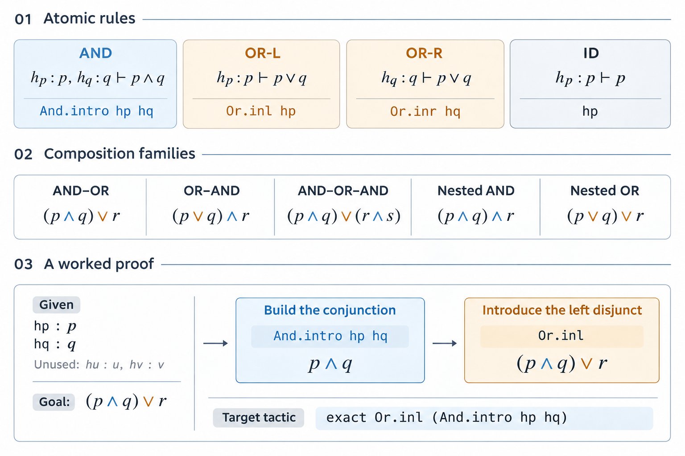
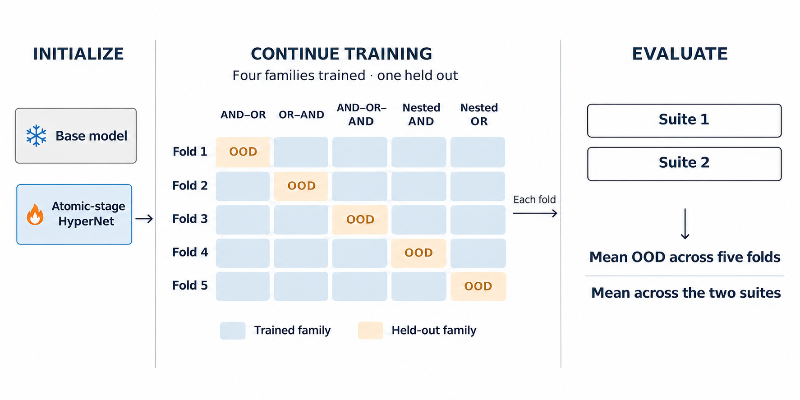

## 3. Main experiments: does circuit information improve reasoning and generalization?

We evaluate the method in stages. On Lean logic proofs, we first examine (1) per-query correction on learned atomic tasks, (2) zero-shot compositional transfer after training only on atomic tasks, and (3) five-fold OOD generalization after further training on compositions. We then extend the method to ARC-AGI-1 grid reasoning, testing both direct parameter generation and its use as a warm start for test-time fine-tuning (TTFT).

### 3.1 Lean: task construction, baselines, and evaluation protocol

We use [Sheng and Fu's generator for Lean logic tasks](https://arxiv.org/html/2607.18921v3#S3.SS1) (2026), expressed in Lean 4 proof syntax ([de Moura &amp; Ullrich, 2021](https://doi.org/10.1007/978-3-030-79876-5_37)). Each problem provides a set of available premises and a goal to prove. The model must predict the first tactic, or proof command, that advances the proof. The task set comprises four atomic operations and five compositional goals (Figure 3):

- **Four atomic operations:** **AND** constructs p ∧ q from p and q; **OR-L** derives p ∨ q from p; **OR-R** derives p ∨ q from q; and **ID** proves p by directly citing an existing premise p.
- **Five compositional goals:** **And-Or**, (p ∧ q) ∨ r; **Or-And**, (p ∨ q) ∧ r; **And-Or-And**, (p ∧ q) ∨ (r ∧ s); **Nested AND**, (p ∧ q) ∧ r; and **Nested OR**, (p ∨ q) ∨ r.

During data generation, the logical rules remain fixed, while proposition names, hypothesis names, and premise order are randomized. Distractor premises are also included to prevent memorization of fixed problem statements. All evaluations use greedy decoding and measure strict exact-match accuracy on the first tactic.

*Figure 3: The four atomic operations and five compositional goals in Lean, together with an And-Or proof that combines atomic operations: first constructing a conjunction with `And.intro`, then introducing a disjunction with `Or.inl`.*

All adaptation methods share the same base model, which has been supervised fine-tuned on the four atomic tasks. We compare four methods on this backbone:

- **Direct SFT**, introduced at the compositional stage, continues fine-tuning the base-model weights directly.
- **Query-only HyperNet** freezes the base model and generates per-query LoRA parameters from the problem text alone. This is the central control for measuring the added benefit of circuit information.
- **Raw-weight HyperNet** freezes the base model and generates LoRA parameters from both the query and a representation of the base model's static weights, echoing weight-conditioned hypernetworks such as [LoFA (Hao et al., 2026)](https://arxiv.org/html/2512.08785v1#S3.SS3) and [Prompt2Effect (Yang et al., 2026)](https://arxiv.org/html/2606.13971v3#S3.SS2). This provides another way to condition on information about the model itself.
- **C-HyperNet** freezes the base model and generates LoRA parameters from the query and the 397-dimensional circuit vector extracted from its first attempt at that problem.

HyperNet training has two stages. The first uses supervised training on the four atomic tasks only. The second introduces selected compositional tasks and evaluates OOD generalization through five-fold leave-one-composition-family-out evaluation. Formal results are reported on two independently generated evaluation banks, Suite 1 and Suite 2. Each bank covers all 9 task families, with 500 problems per family. Atomic scores give equal weight to the four atomic families, and compositional scores give equal weight to the five compositional families. We then average the two suites with equal weight.

### 3.2 Atomic tasks: how effective is per-query parameter generation?

We begin with the most basic question: for task types that the model has already learned, can dynamically generating a LoRA for each new problem improve on the frozen backbone trained with atomic-task SFT?

| Method | Suite 1 (%) | Suite 2 (%) | Two-suite mean (%) |
|---|---:|---:|---:|
| Base model (atomic-task SFT) | 45.15 | 42.80 | 43.98 |
| Query-only | 70.70 | 67.30 | 69.00 |
| Raw-weight | 66.15 | 64.35 | 65.25 |
| **C-HyperNet** | **72.45** | **69.55** | **71.00** |

Dynamic LoRA generation produces substantial gains: all three HyperNets raise mean accuracy from the backbone's 43.98% to above 65%. C-HyperNet ranks first on both independent banks, with a mean of 71.00%. It exceeds Query-only, which reads only the problem text, by 2.00 percentage points, and Raw-weight, which reads static weights, by 5.75 percentage points. These results indicate that in this setting, even for familiar task types, conditioning on a summary of the base model's computation on the current problem outperforms using only the query or static weights.

### 3.3 Zero-shot compositional transfer after atomic-only training

We leave these first-stage models unchanged: none has encountered a compositional training example. We evaluate them directly on the five compositional tasks to examine the starting point for zero-shot transfer under each form of conditioning.

| Model | Suite 1 (%) | Suite 2 (%) | Two-suite mean (%) |
|---|---:|---:|---:|
| Base model | 0.08 | 0.04 | 0.06 |
| Query-only | 2.44 | 2.32 | 2.38 |
| Raw-weight | 4.60 | 3.92 | 4.26 |
| **C-HyperNet** | **6.92** | **5.52** | **6.22** |

Without adaptation, the base model scores almost zero on compositional problems: 0.06%. All three HyperNets show some transfer, with exactly the same ranking on both banks. C-HyperNet reaches 6.22%, exceeding Query-only by 3.84 percentage points and Raw-weight by nearly 2 percentage points. Absolute scores remain low, but this difference supports our intuition: even before any compositional supervision, circuit information is beginning to connect unfamiliar combinations with learned atomic capabilities.

### 3.4 OOD generalization after further compositional training

We next turn to the central test: after learning some ways of combining operations, can a model generalize to a composition family it has never seen during training (following staged atomic-to-compositional evaluation, [Yuan et al., 2025](https://arxiv.org/abs/2509.25123))? We use a five-fold leave-one-composition-family-out setup (Figure 4). Each fold starts from the same atomic-stage checkpoint for its method, continues training on four composition families, and is evaluated on the fifth, held-out family. To mitigate catastrophic forgetting of atomic capabilities, compositional training for all four methods replays atomic examples and adds a KL-divergence regularization term against each method's frozen atomic-stage output distribution ([Li &amp; Hoiem, 2016](https://arxiv.org/abs/1606.09282)), alongside supervision from the reference answers.

*Figure 4: The five-fold protocol for further compositional training and evaluation. All five folds of a method independently start from its same atomic checkpoint. Blue marks the four composition families used in training; orange marks the held-out OOD family. Within each formal evaluation suite, we first average OOD accuracy equally across the five folds, then take the mean across the two suites.*

| Method | Validation (%) | Suite 1 OOD (%) | Suite 2 OOD (%) | OOD mean (%) |
|---|---:|---:|---:|---:|
| Direct SFT | 66.51 | 7.24 | 5.44 | 6.34 |
| Query-only | 74.44 | 4.96 | 4.24 | 4.60 |
| Raw-weight | 80.01 | 10.80 | 10.36 | 10.58 |
| **C-HyperNet** | **81.00** | **13.12** | **13.16** | **13.14** |

*Note: Validation is the equally weighted five-fold mean accuracy on the four seen composition families in the development set used for model selection. After fixing the selected models, we evaluate the held-out families on the two formal banks, reported as Suite 1 and Suite 2 OOD.*

The comparison reveals a clear pattern:

- **Conditioning only on the problem text is prone to overfitting.** Query-only exceeds Direct SFT by nearly 8 percentage points on seen-composition validation accuracy, yet its OOD composition score falls to 4.60%, below even Direct SFT's 6.34%.
- **Conditioning on the base model's own information raises mean OOD accuracy.** Raw-weight, which reads the base model's static weights, reaches an OOD mean of 10.58%. Using the dynamic circuit from the current inference instead raises C-HyperNet to **13.14%**, with closely matched scores across the two suites, 13.12% and 13.16%. It leads Query-only by 8.54 percentage points and Direct SFT by 6.80 percentage points.
- **The gains are unevenly distributed.** At the family level, the advantage is concentrated in **And-Or**: C-HyperNet's two-suite mean is 43.00%, compared with 27.00% for Raw-weight and just 2.40% for Query-only. On **Nested OR**, C-HyperNet reaches 22.70%, slightly below Raw-weight's 25.90%. C-HyperNet still scores 0% on the other three composition families. The current gains therefore apply mainly to particular structures; coverage of the full range of compositions remains limited.

We also examine performance on seen compositions and retention of atomic capabilities. All values below are equally weighted means across the two formal suites:

| Method | Seen compositions (%) | Atomic tasks: before → after continued training (%) |
|---|---:|---:|
| Direct SFT | 65.35 | 43.98 → 55.30 |
| Query-only | 74.35 | 69.00 → 79.51 |
| Raw-weight | 79.86 | 65.25 → **79.56** |
| **C-HyperNet** | **80.79** | 71.00 → 76.00 |

C-HyperNet has the highest accuracy on both OOD and seen compositions, reaching 80.79% on the latter. Its atomic-task accuracy also rises to 76.00% after continued training, although the increase is smaller than for Query-only and Raw-weight.

#### Training-stage pairing-shuffle control

To verify that C-HyperNet's gains require genuine problem-to-circuit alignment rather than merely an extra conditioning token, we run a **stage-2 shuffled training** control (evaluated on the same two 500-problem formal suites). All five folds start from the matched atomic checkpoint with identical steps (12,000), distillation, and per-batch marginal circuit distributions, permuting only student `query–circuit` pairings during training before matched evaluation.

| Training condition (C-HyperNet, seed 42) | Suite 1 OOD (%) | Suite 2 OOD (%) | OOD mean (%) | And-Or / Nested OR (%) |
|---|---|---:|---:|---:|
| Matched training (main table) | 13.12 | 13.16 | **13.14** | 43.00 / 22.70 |
| **Stage-2 shuffled training** | 6.68 | 7.36 | **7.02** | 15.70 / 18.60 |

*Note: Stage-2 shuffled training achieves `0.80%` (`8/1,000`) on `And-Or-And`, `78.63%` on seen compositions, and `74.42%` atomic retention (vs. `80.79%` and `76.00%` matched).*

Shuffling query–circuit pairs during stage-2 training reduced mean held-out first-tactic accuracy from 13.14% to 7.02%, with the largest drop on And-Or (43.00% to 15.70%).

Swapping circuit summaries within the same proof family at inference barely changed the score: 13.16% instead of 13.14%. The evidence is therefore stronger for exploiting patterns shared by related problems than for diagnosing the unique mistake in each attempt.

### 3.5 Extending to grid reasoning: ARC-AGI-1 and test-time fine-tuning

To test whether the approach extends beyond symbolic logic proofs, we conduct two experiments on the abstract grid-reasoning benchmark [ARC-AGI-1](https://arxiv.org/abs/1911.01547) (Chollet, 2019). Our backbone is Qwen3-4B ([Yang et al., 2025](https://arxiv.org/abs/2505.09388)) trained on [RE-ARC](https://arxiv.org/abs/2404.07353) (Hodel, 2024) data, following a grid-adaptation pipeline derived from [NVARC (Sorokin &amp; Puget, 2025)](https://github.com/1ytic/NVARC/blob/main/nvarc_2025.pdf). Direct SFT updates its parameters directly, whereas C-HyperNet freezes the backbone and generates LoRA parameters from the problem representation and a 59-dimensional circuit vector. Evaluation covers all 400 public validation tasks, comprising 419 test inputs, and uses constrained greedy decoding with voting over candidates from multiple views. The main metric is `selected_exact@2`, averaged equally across tasks: two candidates are selected for each test input, and the input is scored as correct if either candidate exactly matches the ground-truth grid. This validation set is also used for checkpoint selection.

#### Applying the generated LoRA directly

| Method | `selected_exact@2` (%) |
|---|---:|
| Frozen base model | 16.375 |
| Direct SFT | 17.125 |
| **C-HyperNet** | **17.250** |

In direct inference, C-HyperNet raises accuracy from the frozen backbone's 16.375% to 17.250%, comparable to Direct SFT at 17.125%. The two adaptation methods use different training budgets, so we report the small 0.125-percentage-point difference only as a numerical observation. The main finding is that the C-HyperNet framework also transfers to visual grid reasoning beyond symbolic tasks (though isolating the circuit vector's incremental contribution over a query-only hypernetwork on ARC remains for future work).

#### Using the generated LoRA as a warm start for TTFT

A more revealing use is to **initialize test-time fine-tuning** ([Sun et al., 2020](https://arxiv.org/abs/1909.13231); [Akyürek et al., 2025](https://arxiv.org/abs/2411.07279)) **with the generated LoRA**, echoing earlier evidence that hypernetwork-generated parameters can warm-start downstream fine-tuning ([Phang et al., 2023](https://arxiv.org/abs/2211.12485)). For a new ARC problem, HyperNet first generates a problem-specific LoRA initialization from the query and circuit. We then continue fine-tuning on the input–output examples provided with that problem. On the same supervised fine-tuned base model, we compare standard LoRA initialization with HyperNet-generated initialization; the original base model with standard initialization serves as an additional reference. All three methods use exactly the same LoRA capacity, 128 augmented training examples per task, 128 parameter updates, and the same learning rate. Only LoRA is updated at test time; both the base model and HyperNet remain frozen.

| TTFT backbone | LoRA initialization | `selected_exact@2` (%) |
|---|---|---:|
| Original base model | Standard | 42.625 |
| Supervised fine-tuned base model | Standard | 45.875 |
| Supervised fine-tuned base model | **HyperNet-generated** | **47.875** |

With standard initialization fixed, the stronger Direct SFT backbone adds 3.25 percentage points, from 42.625% to 45.875%. Holding that stronger backbone fixed, **switching to a LoRA initialization generated by C-HyperNet adds another 2.00 percentage points, from 45.875% to 47.875%**. This suggests that even when direct generation cannot solve a difficult problem in one attempt, the generated parameters have already placed the model at a more favorable starting point for optimization on that task. See the [supporting TTFT results record](ttft_results_en.md) for checkpoint identities, matched adaptation settings, and task-level counts.
