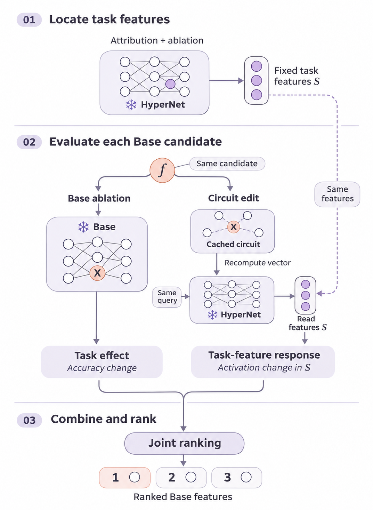

## 5. Functional nodes: using HyperNet to locate nodes in the base model

If HyperNet has learned to identify task-relevant internal computation from a circuit, a natural question follows: **can we use HyperNet as a probe to help locate functional nodes in the base model itself?**

The idea is straightforward: modify a candidate node in the base model's cached computational graph, recompute the circuit vector, and observe how the activations of the corresponding task nodes inside HyperNet change. These responses could indicate how important the candidate is to the target function. Ideally, this would avoid the cost of ablating each candidate and running the base model through a complete inference pass, reserving actual base-model ablations for final validation.

In the current implementation, however, HyperNet reads a compressed vector of fixed length rather than the original graph. Some node and edge details are inevitably lost, and HyperNet responses alone do not yet support reliable selection. We therefore incorporate those responses into the established [attribution and ablation workflow](https://transformer-circuits.pub/2025/attribution-graphs/methods.html) (Ameisen et al., 2025), testing whether **joint selection** can locate the base model's functional nodes more precisely than selection using that workflow alone.

*Figure 5: Three steps for locating functional nodes in the base model (labeled `Base` in the figure) with HyperNet. First, identify and fix a group of task-relevant SAE features in HyperNet. Next, collect two types of evidence for each candidate node in the base model: the task effect of an actual base-model ablation, and the response of HyperNet task features after deleting the corresponding nodes from the cached graph. Finally, combine the evidence to rerank and select base-model nodes. Snowflakes indicate frozen weights; the architecture and rankings are schematic.*

### 5.1 Three steps for joint selection

1. **Fix the HyperNet task readout group.** Decompose intermediate HyperNet activations with a [sparse autoencoder (SAE)](https://arxiv.org/abs/2309.08600) (Cunningham et al., 2023), then combine attribution and ablation to identify a group of HyperNet features that plays an important role in the target atomic task. Ablation subtracts the candidates' decoded contributions while preserving the reconstruction residual; HyperNet then regenerates the LoRA, and we measure the change in the base model's performance. Fix this feature group as the readout for subsequent analysis.
2. **Collect two types of evidence for each base-model candidate.** Candidates are sparse features extracted by the base model's MLP Transcoder, identified by layer and feature index. For each candidate, record its task effect under an actual base-model ablation using the established workflow. Separately, remove all corresponding nodes and edges from a copy of the original cached graph, recompute the circuit vector, and feed it to HyperNet with the query and model weights unchanged. Measure the normalized activation changes of the fixed SAE feature group, and construct an auxiliary ranking score from the target-task response minus a penalty for responses on other tasks.
3. **Rerank jointly and validate independently without LoRA.** The control route, or direct selection, chooses nodes using only base-model attribution and actual ablation effects. Joint selection adds the HyperNet readout signal within the same candidate pool, refining groups through rank fusion, intersection-first filling, or replacements that preserve the node count. Every candidate group undergoes actual base-model ablation evaluation on development data. Finally, each route fixes a group containing **the same number** of base-model nodes and uses fresh problems to test their effects on the **original base model without any LoRA**, directly measuring their contribution to the base model's own functions.

### 5.2 Metric: the functional selectivity ratio R

Successful localization should affect the intended function while limiting effects elsewhere. We characterize functional selectivity with three quantities:

- **Target loss L:** the relative decrease in the number of correctly answered target-task problems after intervention.
- **Other-task change C:** for each of the other three atomic tasks, take the **absolute value** of the net change in correct-answer count; sum these values and divide by the total correct-answer count on those tasks before intervention. Taking the absolute value separately prevents gains on one task from canceling losses on another.
- **Selectivity ratio R = L / C:** a larger ratio indicates that the selected nodes' effects are more concentrated on the target function.

> **Development selection thresholds:** For the HyperNet readout group, we first seek L ≥ 40% and L − C > 10 percentage points. If the search still finds no qualifying group, as in the OR-R case, we choose an exploratory readout from candidates that pass the SAE fidelity check. It must have positive target loss and a positive selectivity gap, and maximize L − C; ties favor larger target loss and then smaller changes on other tasks. The group remains marked as below threshold, and its usefulness is judged independently in subsequent validation on fresh problems. For base-model node selection, the direct control prioritizes R among groups that actually impair the target task. Joint selection first prioritizes a target loss of at least 40%, then ranks by R. Direct controls do not use the new SAE readout signal introduced in this round.

### 5.3 Localization results on fresh problems from four atomic tasks

For AND, OR-L, OR-R, and ID, we independently validate actual base-model ablations on 100 fresh problems per task. The table reports “direct selection → joint selection.” Within each target task, the two routes ablate the same number of base-model nodes.

| Target task | Target loss L (%) | Other-task change C (%) | Selectivity R |
|---|---:|---:|---:|
| AND | 32.35 → 35.29 | 14.49 → 13.04 | 2.23 → **2.71** |
| OR-L | 41.46 → 43.90 | 6.29 → 5.59 | 6.59 → **7.85** |
| OR-R | 68.00 → 52.00 | 42.07 → 18.62 | 1.62 → **2.79** |
| ID | 59.72 → 56.94 | 14.81 → 8.33 | 4.03 → **6.83** |

In the current confirmation results for all four atomic tasks, joint selection consistently has a higher point estimate of R than direct selection, with the four-task mean rising from 3.62 to 5.04. The improvements take two forms. On **AND** and **OR-L**, joint selection causes greater target impairment and smaller changes on other tasks. On **OR-R** and **ID**, it trades some target impairment for a much larger reduction in effects on other tasks; for example, OR-R's C falls from 42.07% to 18.62%. See the [supporting results](localization_results_en.md) for raw counts, node counts, confidence intervals, and the provenance of controls across rounds.
