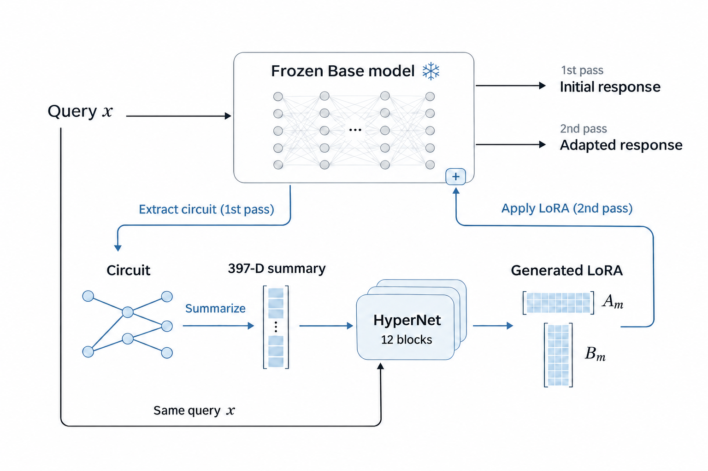
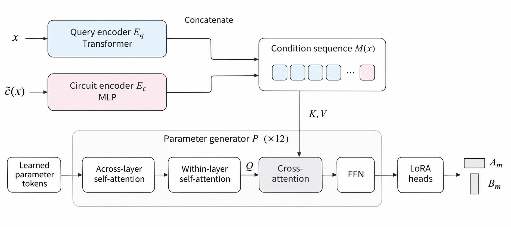

## 2. Method: how does the circuit participate in parameter generation?

*Figure 1: C-HyperNet's two-pass inference loop (with the frozen base model labeled `Frozen Base model`). A circuit is extracted from the frozen base model's first attempt and summarized as a fixed-length vector. Together with the original query, it conditions HyperNet's generation of a per-query LoRA for a second attempt by the same base model. The 397 dimensions and 12 blocks shown correspond to the Lean implementation.*

C-HyperNet follows a two-pass inference procedure: **first observe the internal computation, then generate a parameter update** (Figure 1). Given a problem (query), the frozen base model makes an initial attempt without an adapter. We extract a local attribution graph from this computation and compress it into a fixed-length circuit vector. HyperNet then reads both the original query and the circuit vector to generate a set of [LoRA parameters](https://openreview.net/forum?id=nZeVKeeFYf9) (Hu et al., 2022) for that problem. Finally, we apply the LoRA to the base model, whose original weights remain frozen, and ask it to answer the same query again.

### 2.1 Extracting a circuit vector from inference

We use local attribution graphs to characterize an individual inference run ([Circuit Tracing](https://transformer-circuits.pub/2025/attribution-graphs/methods.html), Ameisen et al., 2025). A pretrained, frozen sparse [Transcoder](https://proceedings.neurips.cc/paper_files/paper/2024/hash/2b8f4db0464cc5b6e9d5e6bea4b9f308-Abstract-Conference.html) (Dunefsky et al., 2024) decomposes the base model's feed-forward computation into sparse feature contributions and a reconstruction residual. Feature activations and local derivatives are then used to estimate direct influence between nodes, and the graph is pruned by attribution importance ([Syed et al., 2024](https://arxiv.org/abs/2310.10348); [Marks et al., 2025](https://arxiv.org/abs/2403.19647); [Ameisen et al., 2025](https://transformer-circuits.pub/2025/attribution-graphs/methods.html)).

Because graph sizes vary across problems, we extract statistics of feature activity by layer, attribution-flow distributions, graph connectivity, and token positions, summarizing the graph as a fixed-length circuit vector, following the graph-summary approach of [CRV (Zhao et al., 2025)](https://arxiv.org/abs/2510.09312) and [CodeCircuit (He et al., 2026)](https://arxiv.org/abs/2602.07080)—397 dimensions in the Lean experiments. Extraction uses only the base model's own first answer and does not require access to the reference answer.

### 2.2 A parameter generator conditioned on query and circuit

*Figure 2: HyperNet in the Lean implementation. A Transformer encodes the query, while an MLP maps the circuit vector to a token of the same width. The two are concatenated into a shared conditioning sequence. Parameter tokens serve as cross-attention queries (Q) over this sequence (K, V), and output heads generate LoRA factors for each target module.*

HyperNet brings together what the problem asks (the query) and how the base model just processed it (the circuit). In the Lean implementation (Figure 2), a Transformer encodes the query as a sequence of token representations, and an MLP maps the circuit vector to one token of the same dimensionality. Concatenating them creates a shared conditioning sequence. The parameter generator uses an architecture in the style of [HY-WU](https://arxiv.org/abs/2603.07236) (Wu et al., 2026): it maintains learnable parameter tokens, each corresponding to a target LoRA parameter slot. These tokens coordinate through self-attention and read the shared conditioning sequence through cross-attention. After multiple layers of interaction, output heads generate low-rank factors A and B for each target linear layer in the base model. Their scaled product forms the weight update for the current query. This LoRA remains fixed throughout the second attempt and is generated anew for the next problem.

### 2.3 End-to-end training

During training, the base model and the circuit extractor are frozen. Only HyperNet is updated, including its query encoder, circuit encoder, parameter generator, and output heads. For each example, HyperNet generates LoRA parameters from the query and its circuit vector, applies them to the base model, and receives supervision from the adapted model's prediction loss on the correct answer—whether the adapter makes the reference answer more likely, rather than a label identifying any faulty step (with no reference answer needed at inference time). Although the base model's weights do not change, gradients pass through its computation and the generated LoRA back to HyperNet. We also penalize excessively large weight updates and cases where the adapted loss exceeds the original unadapted loss, to stabilize training and limit damage to existing capabilities.
